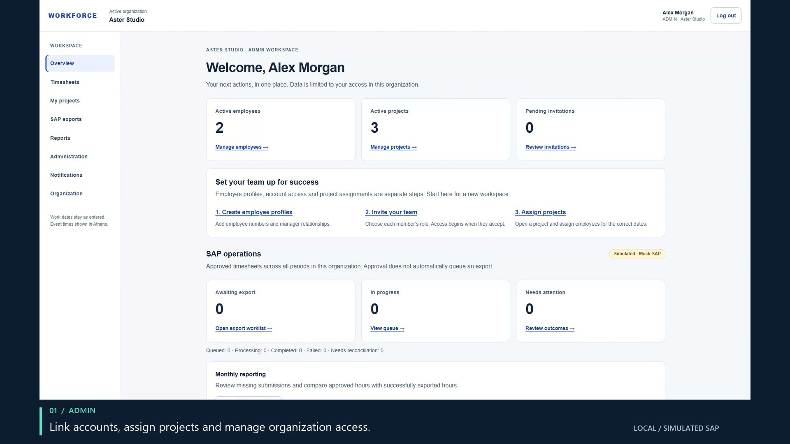
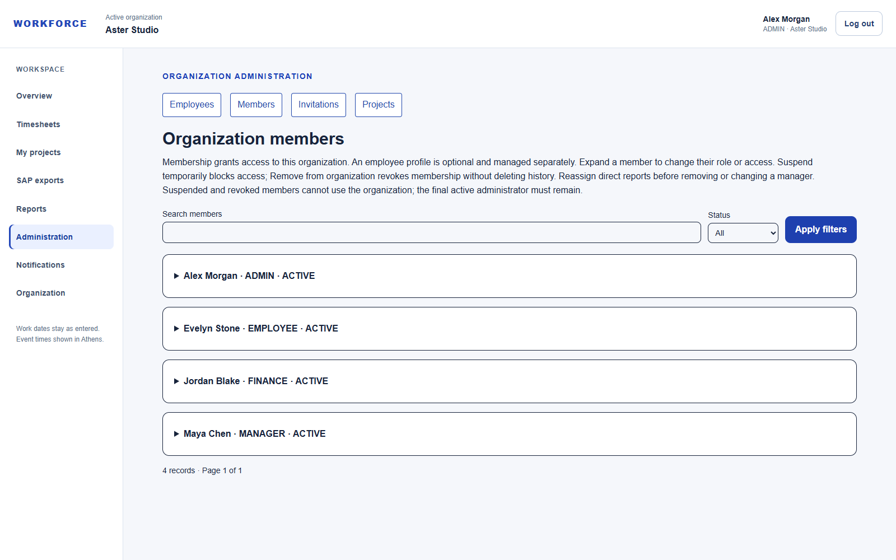
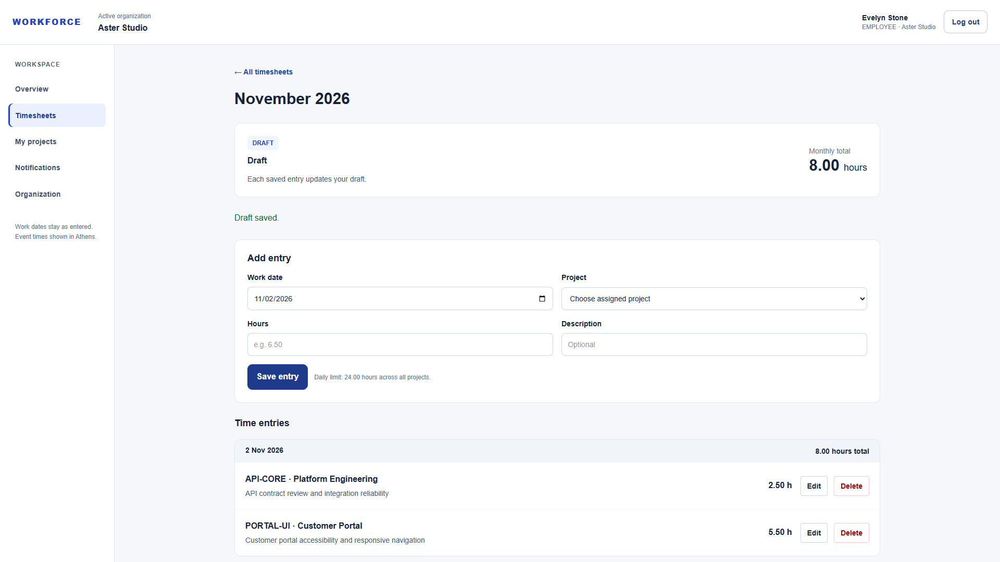
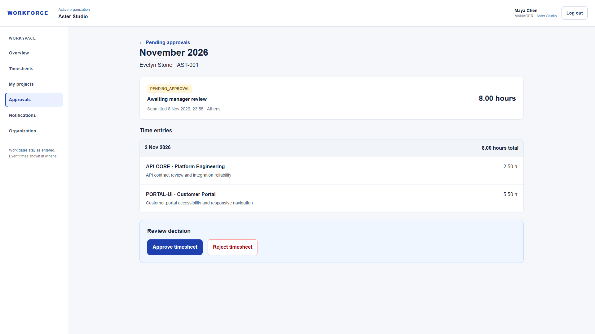
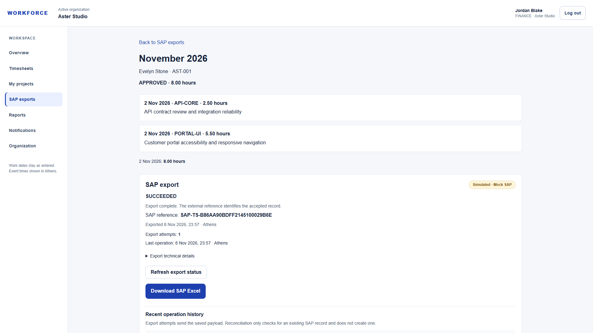
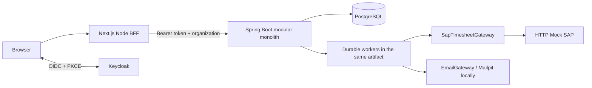

<div align="center">

# Workforce
### Timesheets, approvals & reliable SAP export

A multi-tenant business application that takes employee time from a draft to a manager-approved, auditable export, with real authentication, durable background processing, and role-specific workspaces.

[](https://github.com/wearthewo/sap-timesheet-automation/actions/workflows/ci.yml)
[](https://github.com/wearthewo/sap-timesheet-automation/actions/workflows/e2e.yml)

**Java 21 | Spring Boot 4 | Next.js 16 | React | TypeScript | PostgreSQL | Keycloak**

[Watch the demo](docs/portfolio/video/workforce-demo.mp4) | [Screenshot gallery](docs/portfolio/README.md) | [Architecture](docs/portfolio/architecture.md) | [Run locally](#run-locally)

[](docs/portfolio/video/workforce-demo.mp4)

</div>

> **Demo scope:** genuine footage from the running Phase 12F application, using a separate synthetic organization. SAP is an **HTTP simulator**, and email goes to **local Mailpit**. This repository does not claim a public deployment or a live SAP connection. [Capture provenance and limitations](docs/portfolio/verification.md)

## What this project demonstrates

- **Full-stack ownership:** identity, onboarding, administration, employee workflows, manager decisions, finance operations, deployment preparation and regression coverage.
- **Authorization beyond hidden buttons:** PostgreSQL-owned organization memberships, tenant-scoped resources, direct-report checks and no self-approval.
- **Resilience at the integration boundary:** durable jobs, immutable payload snapshots, stable idempotency identities, bounded retries, leases, claim fencing and reconciliation after uncertain outcomes.
- **Historical integrity:** optimistic locking, append-only decisions/attempts, decimal-safe totals, and downloads generated from the actual export snapshot.
- **Deliberate simplicity:** one Spring Boot modular monolith, one Node-runtime BFF and PostgreSQL as the job authority. No external message broker is needed for this scope.

## Four roles, one connected workflow

| Role | What the user can do | Important boundary |
| --- | --- | --- |
| **ADMIN** | Invite members, link employee profiles, assign managers/projects, manage access, inspect SAP and reports | Cannot bypass direct-manager approval rules; final active administrator is protected |
| **EMPLOYEE** | Record assigned-project hours, submit a month, review rejection comments and reopen a rejected draft | Own timesheets only; pending and approved months are read-only |
| **MANAGER** | Review direct-report entries, approve or reject with an auditable decision | Active linked profile required; no self-review or unrelated employees |
| **FINANCE** | Queue exports, inspect attempts, retry eligible failures, reconcile UNKNOWN outcomes, download reports | Approved timesheets only; no employee-editing or approval override |

<table>
<tr><td width="50%"></td><td width="50%"></td></tr>
<tr><td><strong>Organization-owned access</strong></td><td><strong>Employee time entry</strong></td></tr>
<tr><td></td><td></td></tr>
<tr><td><strong>Manager review</strong></td><td><strong>Asynchronous export</strong></td></tr>
</table>

## Architecture



Spring owns business rules and persistence. Next.js renders the workspace and forwards authenticated commands; bearer tokens are not exposed to browser JavaScript. Keycloak owns credentials, while PostgreSQL memberships own the effective role for the selected organization.

See the [six detailed diagrams](docs/portfolio/architecture.md) for authentication, tenant isolation, lifecycle, SAP processing and notifications.

## Timesheets and approval

`DRAFT -> PENDING_APPROVAL -> APPROVED`

`PENDING_APPROVAL -> REJECTED -> DRAFT` through explicit reopening.

Each entry change checks the current aggregate version and commits entries, totals and the new version atomically. Java `BigDecimal` and PostgreSQL numeric values preserve decimal hours. Assignment validity and the daily-hour limit are enforced by the backend. Manager decisions append immutable history; an approved timesheet stays read-only.

## SAP integration designed for uncertain outcomes

Approval does **not** automatically export. FINANCE or ADMIN queues an approved snapshot and receives `202 Accepted`. The worker claims PostgreSQL jobs with `FOR UPDATE SKIP LOCKED`, commits its lease, then calls the `SapTimesheetGateway` outside a database transaction.

- The stable identity is `SAP_TIMESHEET:<timesheetId>` across attempts.
- Definitive transient failures use bounded exponential backoff.
- Ambiguous acceptance becomes **UNKNOWN** and requires lookup before resending.
- A claim token fences stale worker results; expired leases recover through reconciliation.
- The export, job result and immutable attempt history commit together.
- Successful SAP Excel downloads use the persisted snapshot, not mutable current project or employee data.

**The demonstrated external system is Mock SAP.** It supports success, validation/authentication failures, transient errors, duplicates and timeout-before/after-persistence scenarios. Real production SAP connectivity is future integration work.

[Adapter boundary](docs/sap-integration.md) | [Worker design and failure semantics](docs/sap-export-worker.md)

## Security and multitenancy

OIDC authorization code flow with PKCE and state, encrypted HttpOnly BFF session cookies, validated JWT issuer/audience/expiry, server-side membership checks, tenant-scoped queries and composite ownership constraints work together. A person can hold different roles in different organizations. New identities receive no automatic legacy access.

Invitations bind acceptance to the verified invited identity and store token hashes. Employee-account links cannot be reassigned. Administration records safe audit events and preserves the final active administrator under concurrent changes.

This is an engineering description, **not a security certification**. The local footage uses HTTP development endpoints. Production HTTPS, secrets, SMTP, backups and signed image-release gates are separate deployment requirements. [Production readiness](docs/public-production-readiness.md)

## Reporting and notifications

Finance can filter monthly operational data and download CSV/XLSX reports. Approved-hour and SAP-exported-hour modes have distinct inclusion rules. Bounded database snapshots finish before file formatting; generated workbooks are not persisted in object storage.

Approval/rejection and terminal SAP events create notification intent in the business transaction. PostgreSQL claims, leases, retry limits and deduplication govern delivery. Email runs through `EmailGateway` outside the transaction. The UI exposes recipient-only delivery history. **SENT is not a read receipt**, and ambiguous SMTP acceptance can still produce duplicate physical delivery.

[Reporting semantics](docs/reporting.md) | [Notification rules](docs/notifications.md)

## Testing and CI

| Layer | Verification |
| --- | --- |
| Backend | JUnit / Spring Boot integration tests, PostgreSQL Testcontainers, Flyway and Hibernate validation |
| Concurrency and recovery | Optimistic conflicts, database claims, fencing, retry limits, idempotency and tenant isolation |
| Frontend | ESLint, strict TypeScript, production build and smoke tests |
| Browser | Playwright against the six-service application, real Keycloak flows and exact Mailpit acceptance |
| Mock SAP | HTTP contract, duplicate detection, persistence and failure scenarios |
| Release preparation | Immutable image evidence, scans, SBOMs and signed policy enforcement; no automatic security approval |

The badges link to actual GitHub runs. They do not imply that every local image equals the latest source revision. This documentation work reuses earlier regression evidence and adds the [recorded showcase workflow checks](docs/portfolio/verification.md); it does not claim a fresh full-suite run.

## Run locally

Requirements: Docker Compose, or Java 21 + Node 24 + the repository-declared pnpm for direct development. PostgreSQL only; no H2. Never commit real credentials.

```sh
cp .env.example .env
# Supply independent local values for the required secrets in .env.
docker compose config --quiet
docker compose up --build
```

Default endpoints: app `http://localhost:3000`, Keycloak `http://localhost:8180`, Mailpit `http://localhost:8025`. Register through the application, verify the email in Mailpit, create an organization, then invite the other roles. Fresh startup does not grant access to existing organizations.

The **already-running showcase environment** uses app `http://localhost:33000` and Mailpit `http://localhost:38025`; these are local overrides, not public services. [GUI walkthrough](docs/local-browser-testing-guide.md)

<details>
<summary><strong>Developer commands and repository map</strong></summary>

```text
backend/       Java feature modules, APIs, Flyway and integration tests
frontend/      Next.js UI, BFF, authentication and Playwright
mock-sap/      Separate Node HTTP simulator
infra/         Local services, CI and production preparation
docs/         Architecture, verification, operations and portfolio media
```

```sh
cd backend
./mvnw test
./mvnw clean package -DskipTests

cd ../frontend
pnpm install --frozen-lockfile
pnpm lint
pnpm typecheck
pnpm build
pnpm test:smoke
```

On Windows use `mvnw.cmd`. Database tests need Docker. Browser suites use isolated fixtures: follow the [CI guide](docs/phase8-5-ci-verification.md), not destructive seeding against an existing development database. The [preserved development reference](docs/development-guide.md) retains the previous README's detailed configuration, API and phase-specific instructions.

</details>

## Decisions, trade-offs and limits

| Decision | Benefit | Limit / responsibility |
| --- | --- | --- |
| Modular monolith | Transactional business boundaries, fewer operational components | Modules share a deployment and JVM |
| PostgreSQL job authority | Atomic enqueue and durable concurrency without a broker | Polling and query/lease tuning remain operational concerns |
| Immutable export snapshot | Auditable retries and historically accurate downloads | Schema evolution must preserve old payload compatibility |
| Reconcile UNKNOWN before resending | Avoids duplicate remote creation after lost responses | Depends on external identity lookup and idempotency support |
| BFF session | Tokens stay out of browser JavaScript | Reauthentication is required at token expiry; no automatic refresh claim |
| Local simulators | Reproducible failure testing without customer systems | Does not prove production SAP/SMTP interoperability |

No payroll, finance accounting engine, WebSockets, Kafka, Kubernetes or public deployment is claimed. The running Phase 12F frontend predates the newer organization-form hydration correction; the current source includes it. Production runtime hardening also differs from the local showcase images. [Exact environment differences](docs/portfolio/verification.md)

## Explore the engineering

- [Portfolio gallery and demo](docs/portfolio/README.md)
- [Architecture diagrams and source anchors](docs/portfolio/architecture.md)
- [Full architecture reference](docs/architecture.md)
- [Timesheets](docs/timesheets.md) and [manager approvals](docs/approvals.md)
- [Multitenancy verification](docs/phase9-multitenancy-verification.md)
- [Registration/onboarding](docs/phase10-registration-onboarding-verification.md) and [administration](docs/phase11-administration-verification.md)
- [Phase 12F browser acceptance](docs/phase12f-browser-acceptance.md)
- [Production readiness](docs/public-production-readiness.md), [operations](docs/operations.md) and [backup/restore](docs/backup-restore.md)

All names, organization details and email addresses in the showcase are synthetic. No credentials, session tokens or invitation links are included in the published-media candidates.
