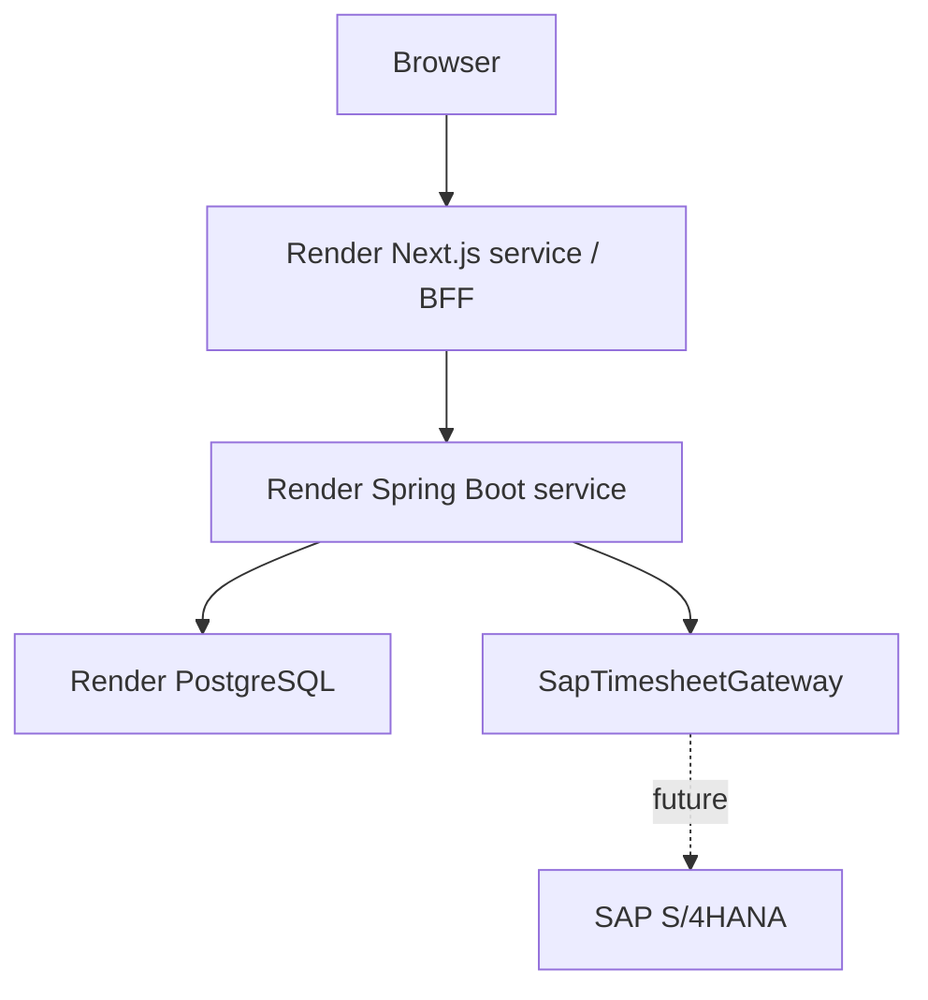

# Platform architecture (Phase 5)

The business needs a consistent employee/project foundation before collecting time and exporting approved work to finance systems. The implemented modules cover identity, employee records, projects, assignments, employee monthly timesheets, manager approval history and durable asynchronous SAP exports.

## Modular monolith

Spring Boot is a single application with feature packages:
- identity: application users, JWT subject provisioning, database role checks.
- employee: employee identity, manager reference, current employee project endpoint.
- project: projects and date-bounded assignments.
- timesheet: owned monthly drafts, date-valid time entries, transactional totals, versioned submission and explicit reopening.
- approval: direct-report manager authorization, pending queue and atomic immutable decisions.
- sap: approved export authorization, durable jobs, fenced claims, retry/reconciliation policy, immutable attempt history, gateway and HTTP adapter.
- common: small shared error, pagination, security and timestamp facilities.

Each feature uses api/application/domain/infrastructure where needed. There are no generic service/repository layers, message brokers or microservices. UUID references keep aggregate boundaries simple and avoid recursive JPA serialization; PostgreSQL foreign keys enforce relationships. A small mapped superclass centralizes UUID and timestamp lifecycle behavior.

## Responsibilities and trust boundaries

Browser → Next.js Node BFF → Spring Boot → PostgreSQL.

Next.js renders the authenticated shell and calls the backend from Server Components and authenticated Server Actions. It owns OIDC protocol/session mechanics and presentation, not domain decisions. It uses Auth.js/NextAuth's stable v4 Keycloak provider with authorization code, PKCE and state. The confidential client secret and backend URL are server-only variables. OIDC endpoints are explicit: authorization uses the public issuer URL; token exchange, userinfo and signing-key requests use KEYCLOAK_INTERNAL_URL. Discovery is disabled so container backchannels do not follow browser-only localhost addresses. ID-token validation still uses the exact public issuer.

Auth.js stores the access token inside an encrypted, HttpOnly, SameSite=Lax JWT session cookie (Secure when NEXTAUTH_URL is HTTPS). This is a stateless encrypted cookie session, not a server-side session database. Browser JavaScript cannot read the cookie; the browser-visible session never contains access or refresh tokens. Server Components and Server Actions decrypt it, check access-token expiration and send Authorization: Bearer to Spring Boot. Sessions require reauthentication at access-token expiry (15 minutes in the local realm); automatic refresh is intentionally deferred. Shared NEXTAUTH_SECRET permits multiple frontend instances. No tokens go into localStorage.

Logout is POST-only with exact Origin checking; it clears all Auth.js cookie chunks and redirects to Keycloak's end-session endpoint. Keycloak may ask for confirmation because no ID token is placed in the redirect. Complete that confirmation to close SSO as well as the local session.

Spring Boot validates JWT signatures, issuer, expiry, audience and a nonblank subject. The Keycloak client includes the basic scope so access tokens carry sub. JWT/Keycloak role claims are not application authorities. Every authenticated API request provisions an application user if absent using PostgreSQL ON CONFLICT, then application authorization consults the current database role. New users always receive EMPLOYEE. Admin writes are enforced with method security. Stateless bearer APIs disable CSRF; browser sessions are handled at the BFF with Auth.js CSRF/state protections.

All browser business-data communication is BFF-only. CORS allowlists remain configurable for explicit future API clients; credentials are disabled and no wildcard is used. API docs and minimal health endpoints are public locally; consider limiting docs at the network boundary before production.

## Persistence and transactions

Spring Boot exclusively owns the workforce database. Keycloak uses a separate keycloak database on the local PostgreSQL server; production should use separate least-privilege credentials. Flyway owns schema changes; Hibernate uses validate. Application users store identity claims and roles, never passwords. Keycloak owns credentials.

Write service methods are transactional; read methods use read-only transactions. Provisioning is a short separate transaction. Database constraints handle races for unique subjects, employee numbers, project codes and active assignments; errors map to stable API codes.

One application user has at most one employee. Employee.manager_id references an employee and may be null. Employee onboarding/manager changes and role promotion are operator actions in this phase, with SQL examples in the README. No administration API is invented.

Project codes are trimmed and case-sensitive. An active assignment blocks a second active assignment for that employee/project even if validity dates do not overlap. Expired rows remain active until explicitly deactivated by an operator. Current project access requires an active employee, active project, active assignment and inclusive validity dates evaluated using the UTC calendar. No employee record returns an empty page. Catalog access includes inactive projects; the employee-specific view filters them.

Lists return content, page, size, totalElements and totalPages, with bounded page sizes and deterministic code/id ordering. DTOs isolate persistence. HTTP errors contain timestamp, status, code, message and path.

## Future boundaries (not implemented)

Future modules: reporting, production SAP adapter,  notifications and broader audit logs.

Phase 4 implements the application-owned SapTimesheetGateway port and a synchronous HTTP adapter targeting a local Node mock. SAP fields and protocol errors stay inside infrastructure. The sap module owns durable export records, deterministic identity, role authorization and safe outcomes. A future production S/4HANA adapter can replace the mock-facing adapter without changing timesheet or approval business logic. PostgreSQL-backed processing now runs within the same backend artifact.

## Render target

The three application services also depend on a separately operated production Keycloak/OIDC service. Local Compose Keycloak start-dev is not a production identity deployment. Use HTTPS and deliberate issuer/client configuration before deploying. No Render resources have been created.

## Timesheet aggregate

The state model is DRAFT → PENDING_APPROVAL → APPROVED or REJECTED, with explicit REJECTED → DRAFT reopening. The timesheet module owns both the monthly aggregate and entries. Self-service ownership comes from the authenticated application user; entries reference projects through UUID foreign keys. Persisted totals, entry changes, and the parent optimistic version commit atomically. Every mutation requires the client version and pending/approved months cannot be changed by employees. Next.js Server Actions propagate authenticated requests and display backend validation without implementing business rules. See [timesheet rules](timesheets.md) for assignment validity, daily limits, error semantics, snapshot reads, and concurrency decisions.

## Approval boundary

The approval module authorizes the database MANAGER role against Employee.managerId, excluding self-review and inactive manager profiles. It uses the existing timesheet aggregate version for atomic status/history writes. Timesheet detail composition includes append-only decision DTOs; no approval entity is exposed. PostgreSQL enforces immutable history in addition to JPA immutability. The employee module remains the source of manager relationships, and identity remains the source of application roles. No independent manager identity or approval microservice was introduced.

See [approvals](approvals.md) for migration, authorization, lifecycle and concurrency rules.

## SAP export boundary

Browser -> Next.js BFF -> API -> PostgreSQL export/job -> Worker -> SapTimesheetGateway -> HTTP SAP adapter -> mock SAP locally / real SAP later.

API commands commit jobs and return 202. The same Spring Boot artifact claims with PostgreSQL SKIP LOCKED and performs external calls outside transactions. Results, job state and immutable history commit together. Lease fencing, stable identity, payload snapshots and reconciliation protect ambiguous outcomes. Repeated enqueue is idempotent. The existing approval status remains APPROVED and is separate from export status.

No Kafka, RabbitMQ, Redis, microservice or separate worker deployment is required. Future Render API instances may disable scheduling while worker-enabled instances use the same artifact and shared database. See [worker architecture](sap-export-worker.md) for status models, configuration, crash recovery and bounded retry policy.
