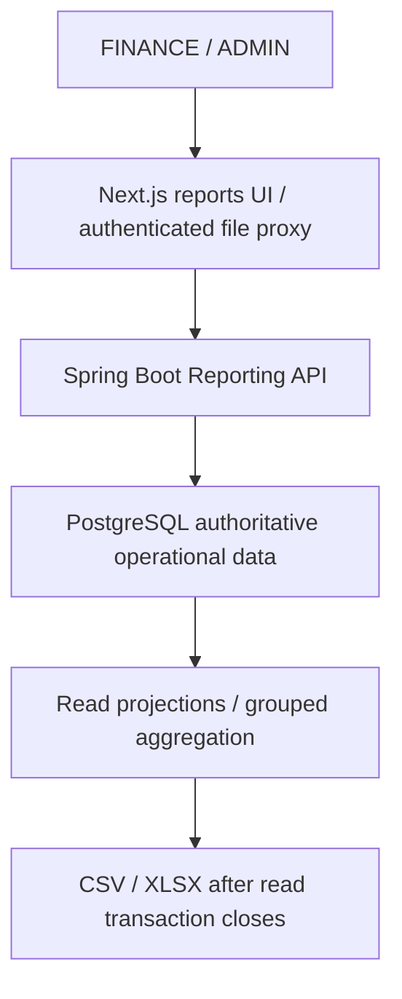
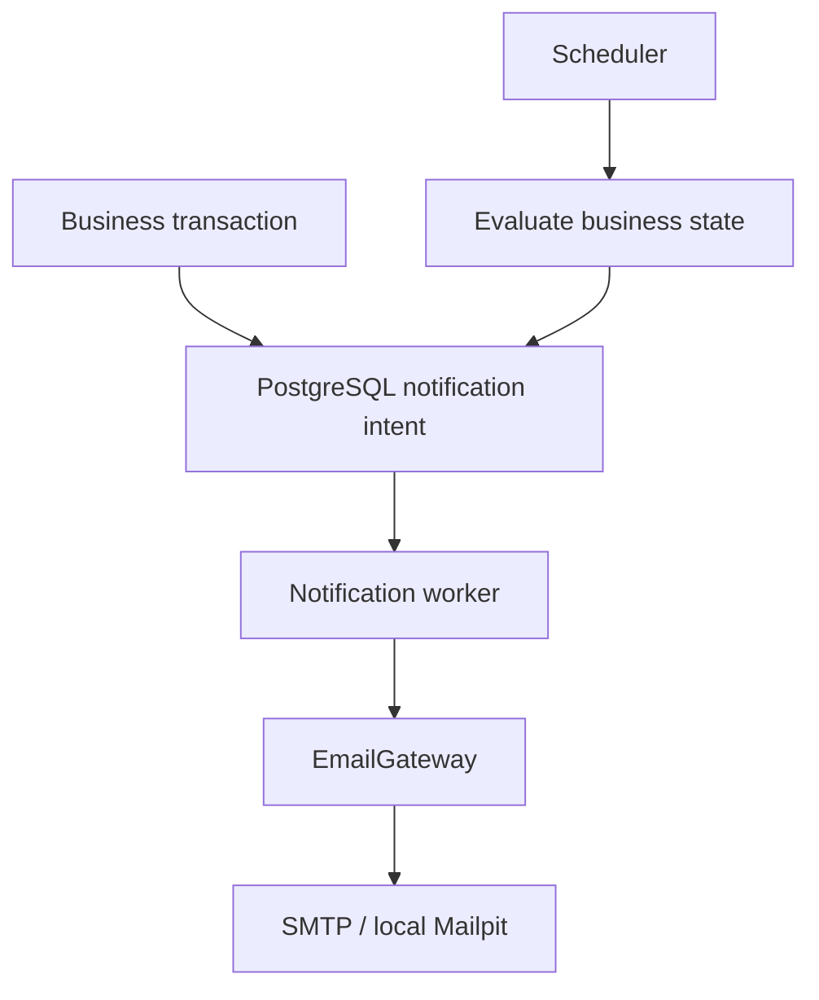

# Platform architecture (Phase 11)

## Organization administration and invitations

Administration extends the existing organization, employee and project features rather than adding another service. `AdministrationAccess` verifies the active tenant ADMIN and serializes sensitive writes on the organization row, then rechecks permission after locking. Employee/membership versions reject stale edits. V17 preserves legacy history, adds optional employee-account linkage and profile names, membership revocation, hashed invitations and immutable audit records. Recursive database guards reject manager cycles; last-admin checks run in both application and database layers.

Invitation acceptance is an authenticated identity-only boundary: a verified JWT email must match the hash-protected invitation, then membership, optional employee linkage and token consumption commit atomically. The ordinary BFF organization selector remains unchanged. A separate server-only HMAC key allows the existing notification worker to construct invitation links transiently without storing plaintext tokens in durable email bodies. SMTP remains outside database transactions. No Keycloak admin API is used in ordinary invitation or acceptance flows.

The responsive `/app/admin` pages use existing authenticated Server Actions and BFF requests. Full roles, employee linkage, manager relations and assignment eligibility remain backend-authoritative. Read [administration](administration.md) for API contracts, lifecycle, expiry, key rotation and delivery limitations.

## Self-service identity and organization bootstrap

Keycloak owns registration, password policy, email verification and account recovery. Workforce does not store passwords or call Keycloak's admin API during organization creation. The Next.js BFF keeps tokens server-side; registration is a second PKCE/state-protected authorization entry point using the same confidential client and issuer.

Identity-only APIs allow provisioning and verification guidance without organization context. Tenant-owned business access and organization creation require a strictly boolean `email_verified=true` from the validated JWT. Membership roles still come only from PostgreSQL.

`organization/application/OrganizationCreation` performs a short transaction: lock the authenticated user row, resolve its idempotency request, create organization, create active ADMIN membership, persist the creation receipt, commit. V16 adds a normalized unique slug index and durable creation receipts. Database uniqueness handles collisions across different users. Replays cannot reactivate suspended memberships or create access to an existing organization. The Server Action sets the HttpOnly organization cookie only after success.

New workspaces have no seeded business data. Tenant query scoping, worker ownership and approval policies remain unchanged. See [onboarding verification](phase10-registration-onboarding-verification.md).

The business needs a consistent employee/project foundation before collecting time and exporting approved work to finance systems. The implemented modules cover identity, employee records, projects, assignments, employee monthly timesheets, manager approval history, durable asynchronous SAP exports and Finance reporting.

## Modular monolith

Spring Boot is a single application with feature packages:
- identity: application users and JWT subject provisioning.
- organization: active memberships and organization-specific database role checks.
- employee: employee identity, manager reference, current employee project endpoint.
- project: projects and date-bounded assignments.
- timesheet: owned monthly drafts, date-valid time entries, transactional totals, versioned submission and explicit reopening.
- approval: direct-report manager authorization, pending queue and atomic immutable decisions.
- sap: approved export authorization, durable jobs, fenced claims, retry/reconciliation policy, immutable attempt history, gateway and HTTP adapter.
- reporting: active-employee operational projections, approved/SAP-exported hour aggregates and bounded CSV/XLSX downloads.
- common: small shared error, pagination, security and timestamp facilities.

Each feature uses api/application/domain/infrastructure where needed. There are no generic service/repository layers, message brokers or microservices. UUID references keep aggregate boundaries simple and avoid recursive JPA serialization; PostgreSQL foreign keys enforce relationships. A small mapped superclass centralizes UUID and timestamp lifecycle behavior.

## Responsibilities and trust boundaries

Phase 9 adds organization ownership throughout the business schema. `X-Organization-Id` is an untrusted selector until the backend checks the authenticated identity's active membership. Membership roles replace global identity roles for authorization. The BFF passes the selected organization from its HttpOnly cookie, checks current active memberships and offers `/organizations` selection. Phases 10 and 11 add self-service onboarding and audited organization administration. Background processing carries persisted organization IDs explicitly and never uses request context. See [Phase 9 isolation](phase9-multitenancy-verification.md) for the schema, legacy-data acknowledgement and complete security contract.

Browser → Next.js Node BFF → Spring Boot → PostgreSQL.

Next.js renders the authenticated shell and calls the backend from Server Components and authenticated Server Actions. It owns OIDC protocol/session mechanics and presentation, not domain decisions. It uses Auth.js/NextAuth's stable v4 Keycloak provider with authorization code, PKCE and state. The confidential client secret and backend URL are server-only variables. OIDC endpoints are explicit: authorization uses the public issuer URL; token exchange, userinfo and signing-key requests use KEYCLOAK_INTERNAL_URL. Discovery is disabled so container backchannels do not follow browser-only localhost addresses. ID-token validation still uses the exact public issuer.

Auth.js stores the access token inside an encrypted, HttpOnly, SameSite=Lax JWT session cookie (Secure when NEXTAUTH_URL is HTTPS). This is a stateless encrypted cookie session, not a server-side session database. Browser JavaScript cannot read the cookie; the browser-visible session never contains access or refresh tokens. Server Components and Server Actions decrypt it, check access-token expiration and send Authorization: Bearer to Spring Boot. Sessions require reauthentication at access-token expiry (15 minutes in the local realm); automatic refresh is intentionally deferred. Shared NEXTAUTH_SECRET permits multiple frontend instances. No tokens go into localStorage.

Logout is POST-only with exact Origin checking; it clears all Auth.js cookie chunks and redirects to Keycloak's end-session endpoint. Keycloak may ask for confirmation because no ID token is placed in the redirect. Complete that confirmation to close SSO as well as the local session.

Spring Boot validates JWT signatures, issuer, expiry, audience and a nonblank subject. The Keycloak client includes the basic scope so access tokens carry sub. JWT/Keycloak role claims are not application authorities. Every authenticated API request provisions an application user if absent using PostgreSQL ON CONFLICT, then application authorization checks active organization membership and its current database role. New users receive no membership. Admin writes are enforced with method security. Stateless bearer APIs disable CSRF; browser sessions are handled at the BFF with Auth.js CSRF/state protections.

All browser business-data communication is BFF-only. CORS allowlists remain configurable for explicit future API clients; credentials are disabled and no wildcard is used. API docs and minimal health endpoints are public locally; consider limiting docs at the network boundary before production.

## Persistence and transactions

Spring Boot exclusively owns the workforce database. Keycloak uses a separate keycloak database on the local PostgreSQL server; production should use separate least-privilege credentials. Flyway owns schema changes; Hibernate uses validate. Application users store identity claims; organization memberships store effective roles. The deprecated global role is not used for authorization. Neither table stores passwords. Keycloak owns credentials.

Write service methods are transactional; read methods use read-only transactions. Provisioning is a short separate transaction. Database constraints handle races for unique subjects, employee numbers, project codes and active assignments; errors map to stable API codes.

One application user has at most one employee per organization. Employee.manager_id references an employee in the same organization and may be null. Organization ADMIN members manage profiles, manager links and membership roles through Phase 11's audited administration APIs. The backend preserves the final active administrator, immutable account links and direct-report review restrictions.

Project codes are trimmed and case-sensitive. An active assignment blocks a second active assignment for that employee/project even if validity dates do not overlap. Expired rows remain active until explicitly deactivated by an operator. Current project access requires an active employee, active project, active assignment and inclusive validity dates evaluated using the UTC calendar. No employee record returns an empty page. Catalog access includes inactive projects; the employee-specific view filters them.

Lists return content, page, size, totalElements and totalPages, with bounded page sizes and deterministic code/id ordering. DTOs isolate persistence. HTTP errors contain timestamp, status, code, message and path.

## Future boundaries (not implemented)

Future modules: production SAP/email adapters and broader audit logs.

Phase 4 implements the application-owned SapTimesheetGateway port and a synchronous HTTP adapter targeting a local Node mock. SAP fields and protocol errors stay inside infrastructure. The sap module owns durable export records, deterministic identity, role authorization and safe outcomes. A future production S/4HANA adapter can replace the mock-facing adapter without changing timesheet or approval business logic. PostgreSQL-backed processing now runs within the same backend artifact.

## Production topology

The [production Compose architecture](production-deployment.md) places Caddy in front of the Next.js BFF and Keycloak. Spring Boot and its durable workers, PostgreSQL and Mock SAP remain on private networks. Only HTTPS ingress is public; Keycloak administration and database ports are not published. Local Keycloak `start-dev` and Mailpit are development facilities, not production identity or email services.

## Timesheet aggregate

The state model is DRAFT → PENDING_APPROVAL → APPROVED or REJECTED, with explicit REJECTED → DRAFT reopening. The timesheet module owns both the monthly aggregate and entries. Self-service ownership comes from the authenticated application user; entries reference projects through UUID foreign keys. Persisted totals, entry changes, and the parent optimistic version commit atomically. Every mutation requires the client version and pending/approved months cannot be changed by employees. Next.js Server Actions propagate authenticated requests and display backend validation without implementing business rules. See [timesheet rules](timesheets.md) for assignment validity, daily limits, error semantics, snapshot reads, and concurrency decisions.

## Approval boundary

The approval module authorizes the database MANAGER role against Employee.managerId, excluding self-review and inactive manager profiles. It uses the existing timesheet aggregate version for atomic status/history writes. Timesheet detail composition includes append-only decision DTOs; no approval entity is exposed. PostgreSQL enforces immutable history in addition to JPA immutability. The employee module remains the source of manager relationships, and identity remains the source of application roles. No independent manager identity or approval microservice was introduced.

See [approvals](approvals.md) for migration, authorization, lifecycle and concurrency rules.

## SAP export boundary

Browser -> Next.js BFF -> API -> PostgreSQL export/job -> Worker -> SapTimesheetGateway -> HTTP SAP adapter -> mock SAP locally / real SAP later.

API commands commit jobs and return 202. The same Spring Boot artifact claims with PostgreSQL SKIP LOCKED and performs external calls outside transactions. Results, job state and immutable history commit together. Lease fencing, stable identity, payload snapshots and reconciliation protect ambiguous outcomes. Repeated enqueue is idempotent. The existing approval status remains APPROVED and is separate from export status.

No Kafka, RabbitMQ, Redis, microservice or separate worker deployment is required. Separately operated API instances may disable scheduling while worker-enabled instances use the same artifact and shared database. See [worker architecture](sap-export-worker.md) for status models, configuration, crash recovery and bounded retry policy.

## Finance reporting boundary (Phase 6)

The reporting feature owns read-only DTOs, reporting-only states, SQL projections and bounded file formatting. It does not own a second copy of timesheets, approvals or SAP state. Database roles authorize every read/download. PostgreSQL numeric and BigDecimal preserve exact totals. Operational rows include currently active employees without a timesheet; approved and SAP-exported details have explicit separate filters. Existing worker/approval transaction boundaries remain unchanged.

No reporting microservice, warehouse, materialized view or new schema migration was justified. Existing join indexes support the read paths. See [reporting](reporting.md) for query strategy, snapshot limits, file layout and inclusion semantics. Payroll remains future scope; email notifications are implemented in Phase 7 below.

## Phase 7 notification module

The notification feature owns business-state evaluation, templates, durable delivery state, owner-only history, and the EmailGateway port. The SMTP implementation stays in its infrastructure package. Approval and SAP result transactions invoke NotificationIntents; they never call SMTP. Scheduled evaluation is independent and testable through an injected Clock.

Database unique keys deduplicate intent. SKIP LOCKED, bounded leases and claim tokens protect delivery across instances. No network call spans a database transaction. SMTP delivery is at-least-once under ambiguous failures; a stable Message-ID does not promise exactly-once receipt. See [notifications.md](notifications.md) for state models, timezone/calendar rules, recipient eligibility, retry classification and privacy boundaries. This adds no external queue, omnichannel framework or deployment.

## Phase 8 additions

SAP download remains inside the SAP feature. A read-only repeatable-read transaction selects authorization, timesheet eligibility, export metadata and the stored payload consistently. The orchestration service suspends any caller transaction; the reader completes before Apache POI formats the document in memory. No SAP request or persistent workbook storage is involved. The BFF streams the authenticated response; browser JavaScript receives only workbook bytes.

V14 protects the existing job payload, export identity association and timesheet association against updates/deletes. Execution state remains mutable. This closes the previous "immutable in practice" gap without changing the queue architecture. Approval history and SAP/notification attempt histories retain their existing database guards.

Notification templates now include authoritative manager names, stable SAP identities and separate monthly missing/DRAFT/pending/rejected counts. Business decision times use explicit Europe/Athens offsets; durable timestamps remain UTC.

## Checkpoint 12B presentation and dashboard

The BFF renders role-specific sections from read-only `/api/v1/dashboard` and existing authorized personal APIs. The backend resolves active membership and returns only relevant role sections. Every aggregate is tenant-scoped; rejected months are owner-only, and manager activity requires current direct-report ownership and that manager's decisions. Lists are capped at five; SQL aggregates avoid loading complete datasets. A repeatable-read transaction provides a consistent projection.

No dashboard writes, new schema or approval overrides. Finance operational counts span all approved months; monthly reports retain their period/filter semantics. Event timestamps use explicit en-GB/Europe/Athens; calendar dates do not shift. Persisted instants and downloaded reports retain UTC. Desktop sidebar and mobile navigation expose the same authorized routes and direct logout.

## Single-VPS runtime preparation (12D)

The application architecture and database schema are unchanged. A separate production Compose definition places a nonroot Caddy HTTPS proxy in front of the Node BFF and production Keycloak. Spring Boot and its PostgreSQL-backed workers share one artifact. Separate database logins own Workforce and Keycloak databases; only the proxy publishes ports. Mock SAP remains private with persistent idempotency state. Runtime file secrets stay outside images and Git.

The operator backup profile quiesces writers, encrypts both database dumps and Mock SAP state, and restores only into an empty target with per-table integrity checks. Generated report/SAP spreadsheets are still on demand and are not stored. Public TLS, native cloud sizing, offsite recovery and real SMTP require later approved verification. See [production deployment](production-deployment.md) and [backup runbook](backup-restore.md). No new migration or service boundary was introduced.
