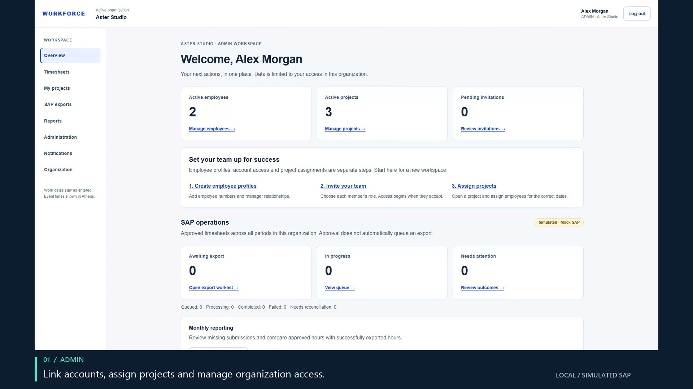
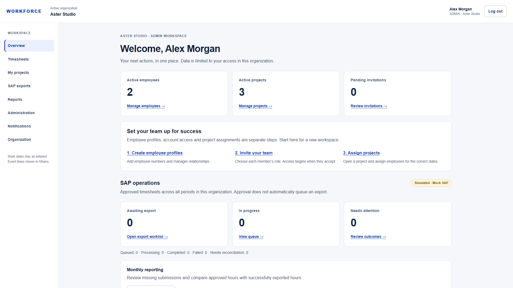
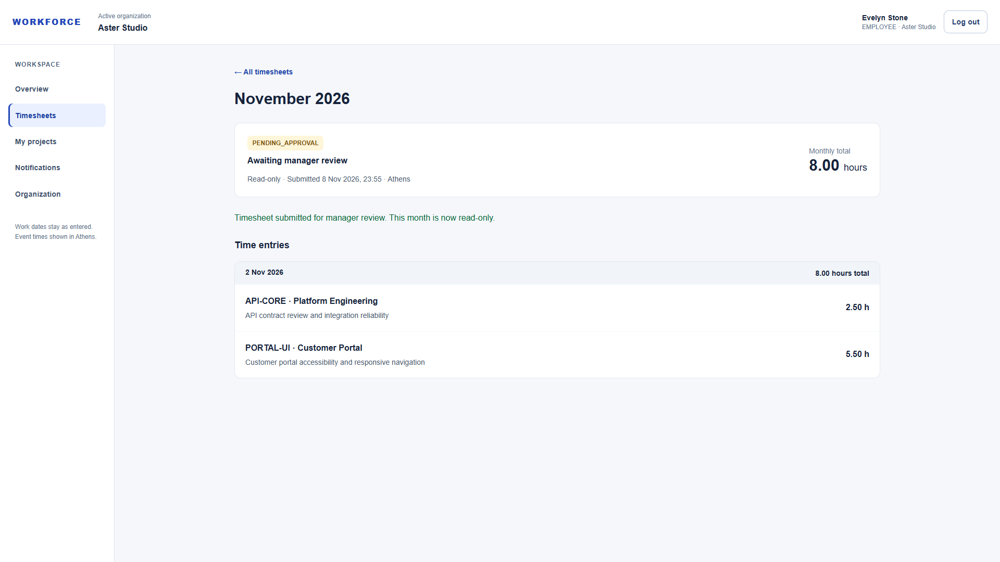
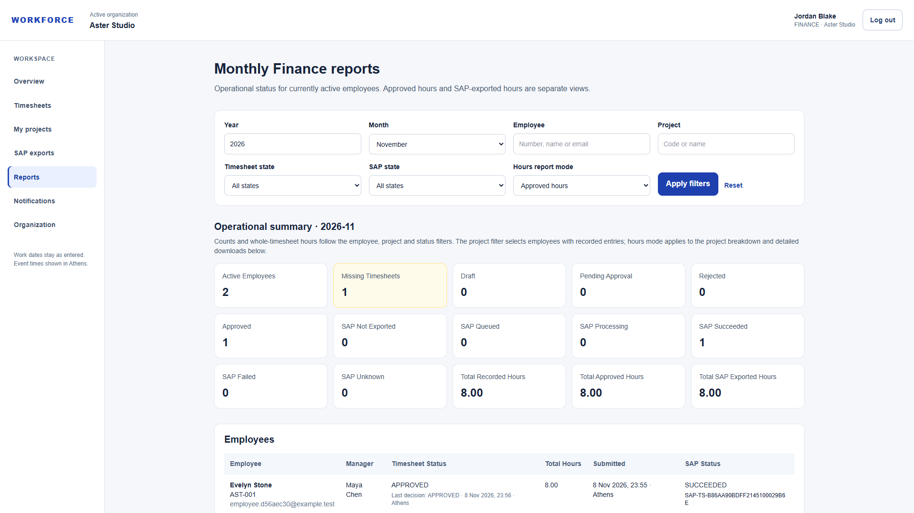
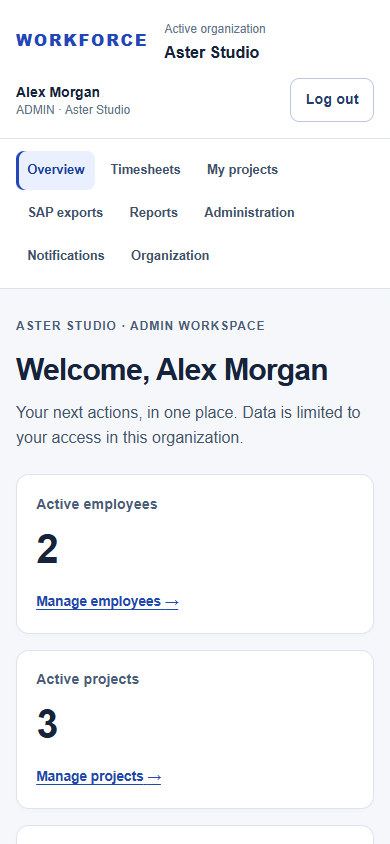
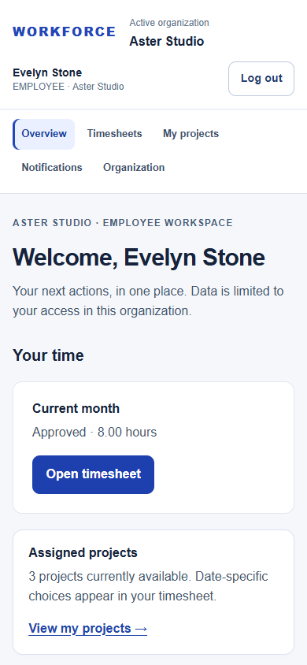
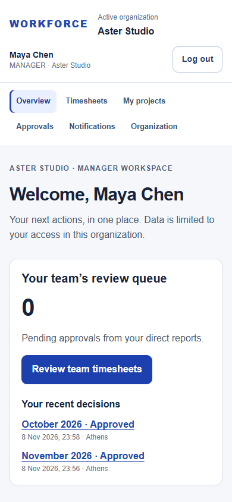
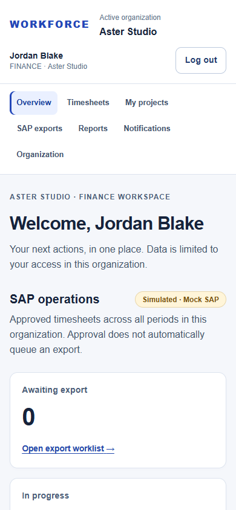

# Workforce — browser showcase

[← Repository overview](../../README.md) · [Architecture](architecture.md) · [Verification and provenance](verification.md)

**[Watch or download the 1:50 MP4](video/workforce-demo.mp4).** Genuine Playwright/Chromium footage, edited for pace with readable captions. No music or narration. All people and records belong to an isolated synthetic organization. **SAP is simulated; email uses local Mailpit.**

## A complete business handoff

The November example records **5.50 + 2.50 = 8.00 hours** across two projects. An employee submits, their direct manager approves, and Finance queues an asynchronous export. Reporting shows eight approved hours and eight SAP-exported hours. A separate October exercise demonstrates timeout-after-acceptance and reconciliation without another export attempt.

| Video | Chapter |
| --- | --- |
| 0:00–0:06 | Introduction and scope |
| 0:06–0:24 | ADMIN: overview, people, projects and assignments |
| 0:24–0:46 | EMPLOYEE: draft, time entry and submission |
| 0:46–1:06 | MANAGER: direct-report review and approval |
| 1:06–1:28 | FINANCE: queue export, confirmed reference and history |
| 1:28–1:40 | Reporting and notification visibility |
| 1:40–1:50 | Architecture and engineering decisions |

## Administration

Profiles, login identities and memberships are separate concepts. The UI links accounts explicitly, assigns a manager and projects, and explains safe lifecycle operations.

| View | Genuine capture |
| --- | --- |
| Empty organization and setup guidance | [Empty overview](screenshots/admin-empty-overview.png) |
| Linked employee and manager | [Employees](screenshots/admin-employees.png) |
| Four active roles | [Organization members](screenshots/admin-members.png) |
| Project catalog, including a clearly named simulator exercise | [Projects](screenshots/admin-projects.png) |
| Effective project assignments | [Assignments](screenshots/admin-assignments.png) |

## Employee and manager

| Stage | Genuine capture |
| --- | --- |
| Role-specific starting point | [Employee overview](screenshots/employee-overview.png) |
| Editable draft and decimal totals | [Draft](screenshots/employee-draft.png) |
| Direct-report queue | [Pending approvals](screenshots/manager-pending.png) |
| Entries and decision controls | [Manager review](screenshots/manager-review.png) |
| Append-only approval outcome | [Decision history](screenshots/manager-decision-history.png) |
| Employee's final read-only record | [Approved month](screenshots/employee-approved.png) |

## Finance and integration resilience

| Stage | Genuine capture |
| --- | --- |
| Approved timesheet waiting for export | [Export worklist](screenshots/finance-worklist.png) |
| Persisted asynchronous queue state | [Queued export](screenshots/finance-queued.png) |
| Confirmed external reference; duplicate action removed | [Successful export](screenshots/finance-export-success.png) |
| Completed operation and duration | [Attempt history](screenshots/finance-attempt-history.png) |
| Remote acceptance is uncertain | [UNKNOWN / reconciliation required](screenshots/finance-reconciliation-required.png) |
| Lookup finds the existing remote record | [Reconciled success](screenshots/finance-reconciled.png) |

The October exercise deliberately uses `MOCK-TIMEOUT`. The final history shows **one export attempt** followed by a successful **reconciliation** operation. The simulator is not represented as SAP certification or production connectivity.

## Notifications and mobile

[Employee approval delivery history](screenshots/employee-notifications.png) · [Finance integration notification history](screenshots/finance-notifications.png)

<table>
<tr><td></td><td></td><td></td><td></td></tr>
<tr><td>ADMIN</td><td>EMPLOYEE</td><td>MANAGER</td><td>FINANCE</td></tr>
</table>

These are Chromium viewport captures, not physical-device or cross-browser certification. Notification history represents server acceptance, not read/unread status.

## Media integrity and publication

The application screenshots are unretouched. Only the MP4 has editorial title cards, captions, pacing changes and transitions. Authentication/verification links and password entry were excluded from recording. There is no real customer information in these fixtures. Original recording files, credentials and downloaded workbooks remain in ignored local evidence and are not part of this portfolio directory.

The final MP4 is small enough for a normal reviewed Git commit; avoid repeatedly committing video revisions. Nothing has been uploaded. If later media grows substantially, publish it as a GitHub Release asset after explicit approval and update the preview link. GitHub Markdown may open the MP4 file view rather than autoplay; downloading the file is also supported.
