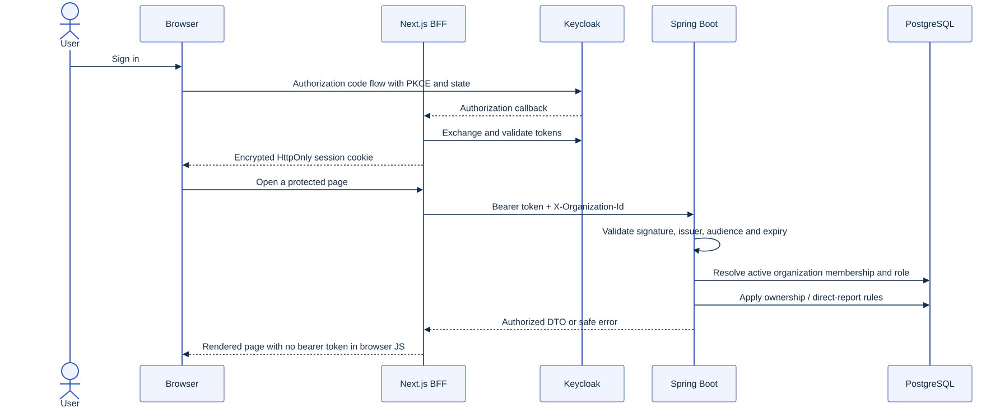

# Architecture behind the demo

The diagrams describe implemented behavior, not a proposed microservice system. Their editable Mermaid sources are in [diagrams/](diagrams/). The full [architecture reference](../architecture.md) contains implementation history.

## One backend, explicit boundaries

Next.js is the Node-runtime BFF; Spring Boot owns authorization, transactions and business rules. Workers run in that same Java artifact. Local Keycloak and the application use separate databases on the PostgreSQL service. Mock SAP is a separate HTTP simulator, and Mailpit is the local SMTP sink.

## Authentication and authorization are different decisions

Keycloak authenticates the identity. An encrypted HttpOnly cookie keeps the BFF's session inaccessible to browser JavaScript. Spring validates the bearer token and resolves active membership from PostgreSQL. JWT role claims do not grant application privileges. Sessions require reauthentication at token expiry; automatic refresh is not claimed. Logout includes Keycloak's confirmation screen.

## Organization isolation

The same person can have different roles in different organizations. Root queries are tenant scoped; composite foreign keys and immutable ownership chains prevent cross-organization relationships. Manager review additionally requires an active profile, a direct-report relationship and no self-review. ADMIN is not a manager-approval bypass.

## Timesheet lifecycle

Entry changes, decimal totals and optimistic versions commit together. Rejection requires a comment and explicit reopening before editing. Approval history is append-only. Approval and SAP export are separate states.

## Durable SAP export

Enqueue persists an immutable payload snapshot and `SAP_TIMESHEET:<timesheetId>` identity. PostgreSQL claims use `SKIP LOCKED`, leases and fenced claim tokens. Network I/O occurs outside the transaction. Ambiguous acceptance and expired claims reconcile before resending. Retries have bounded attempts and capped exponential backoff. This is at-least-once processing with remote idempotency, not exactly-once HTTP delivery.

## Notifications

Business events and notification intent commit atomically. Scheduled evaluation uses the Europe/Athens calendar; durable timestamps are UTC. Recipient-only history shows delivery state, not read/unread state. Deduplicated intent does not eliminate the possibility of duplicate physical email after ambiguous SMTP acceptance.

## Source anchors

| Area | Implementation |
| --- | --- |
| BFF session and tenant propagation | [backend.ts](../../frontend/src/lib/backend.ts), [auth.ts](../../frontend/src/lib/auth.ts) |
| Membership, ownership, business policy | [backend feature packages](../../backend/src/main/java/com/acme/workforce/) |
| SAP queue and lease fencing | [SapJobStore.java](../../backend/src/main/java/com/acme/workforce/sap/infrastructure/SapJobStore.java), [worker documentation](../sap-export-worker.md) |
| Notification claims and scheduling | [NotificationStore.java](../../backend/src/main/java/com/acme/workforce/notification/infrastructure/NotificationStore.java), [NotificationScheduling.java](../../backend/src/main/java/com/acme/workforce/notification/infrastructure/NotificationScheduling.java) |
| Database invariants | [Flyway migrations](../../backend/src/main/resources/db/migration/) |
| Reporting and bounded downloads | [reporting design](../reporting.md), [SAP snapshot downloads](../sap-integration.md) |

The portfolio render was syntax-checked and rendered with a pinned local Mermaid renderer. See the [capture and verification record](verification.md) for actual browser evidence and scope limits.
