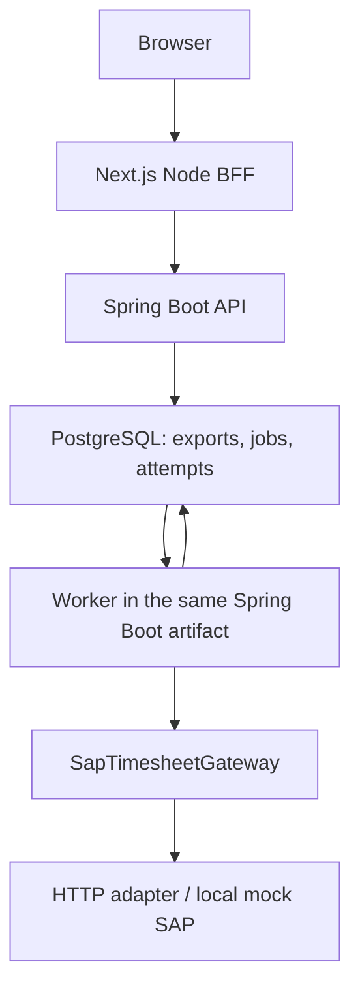

# Durable SAP export worker — Phase 5

## Architecture

PostgreSQL is the durable queue and concurrency authority. There is one Spring Boot artifact, no separate Maven module, external broker or worker deployment. Kafka/RabbitMQ/Redis are unnecessary for this bounded workflow: enqueue and job creation can commit atomically in the existing database, and SKIP LOCKED allows multiple future instances to claim work safely.

The gateway remains independent of HTTP and persistence. It now supports export and optional lookup by stable export identity. The job stores an immutable JSON snapshot (database-protected since V14) of the internal ApprovedTimesheetPayload at enqueue, so later changes to employee numbers or project codes cannot change a retry's payload. Only the infrastructure adapter produces SAP-shaped HTTP fields.

## Status and migration model

Export status describes the integration outcome:

| State | Meaning |
| --- | --- |
| QUEUED | Export is scheduled, possibly after reconciliation/backoff |
| PROCESSING | A worker owns an outbound export attempt |
| SUCCEEDED | Confirmed SAP reference and exported timestamp |
| FAILED | Definite permanent failure or exhausted safe-to-retry attempts |
| UNKNOWN | SAP acceptance has not been established; lookup required before another POST |

Job status describes execution: PENDING, PROCESSING, COMPLETED or FAILED. Its operation is EXPORT or RECONCILE. Thus an UNKNOWN export may have a pending reconciliation job, a running lookup, or a terminal failed lookup awaiting manual reconciliation.

V10 changes the export status constraint and creates sap_export_jobs. V11 creates immutable sap_export_attempts. V1–V9 are untouched. Existing Phase 4 PENDING exports become UNKNOWN and receive reconciliation jobs, because their old process could have sent the request. Existing UNKNOWN records also receive lookup jobs. SUCCEEDED remains completed; FAILED remains terminal and not automatically retryable. Legacy records get a payload snapshot and zero new-worker attempt count; no fabricated execution history is inserted.

There is one unique export per timesheet and one unique job per export/timesheet. A composite FK prevents a job from referencing a different export's timesheet. Database checks enforce valid states, nonnegative counts and consistent lease fields.

## Enqueue and API

Only database FINANCE and ADMIN roles can enqueue, retry or reconcile. Employee/manager status/history reads retain the prior owner/direct-report authorization. UI visibility never substitutes for backend authorization.

- POST /api/v1/sap/timesheets/{id}/export requires X-Timesheet-Version and returns **202 Accepted** promptly. It validates APPROVED state, locks the timesheet row briefly, then creates export + payload snapshot + job in one transaction. Repeated calls return the existing state without resetting attempts, duplicating a job or making a network call, including after success.
- POST /api/v1/sap/timesheets/{id}/export/retry returns 202 for eligible FAILED exports and requeues the existing job.
- POST /api/v1/sap/timesheets/{id}/export/reconcile returns 202 for UNKNOWN exports and advances their lookup job to now.
- GET /api/v1/sap/timesheets/{id}/export returns status, job metadata and the latest 20 completed operations.
- GET /api/v1/sap/timesheets/{id}/export/attempts?page=0&size=20 provides bounded, newest-first history pagination.
- Existing worklist and detail GET endpoints remain available and include job metadata.

Manual commands do not execute SAP. They reject a currently PROCESSING job with 409. Retry is only offered after an exhausted connection failure or a definitive lookup miss; validation/authentication/configuration failures have no force-retry action. UNKNOWN must use reconciliation. SUCCEEDED never executes again.

Approved timesheet contents and version remain unchanged by export operations. The enqueue version check remains; job uniqueness and lease tokens protect the separate integration aggregate.

## Claiming, leases and crash recovery

Each poll claims at most SAP_EXPORT_BATCH_SIZE eligible jobs using SELECT ... FOR UPDATE SKIP LOCKED. Eligibility requires PENDING and next_attempt_at <= clock_timestamp(). The real clock is intentional: PostgreSQL now() is fixed at transaction start, and recovery may schedule a job during that transaction.

The claiming transaction records PROCESSING, locked_at, worker identifier, a fresh UUID claim token and counts, then commits. A bounded virtual-thread batch starts the claimed operations together; jobs do not wait serially for earlier HTTP calls while their leases expire. All HTTP happens outside database transactions.

A separate result transaction locks the job and verifies its claim token. A late result from an expired/replaced claim is ignored. This fencing check prevents an old worker from overwriting a newer decision.

An expired PROCESSING claim is recovered with SKIP LOCKED. Recovery appends an ABANDONED attempt, marks the export UNKNOWN and schedules RECONCILE, **not another blind export**. A fresh lease cannot be stolen. If a worker crashes before HTTP or after SAP accepts, the same recovery path is safe.

The processing lease must exceed connect timeout + response timeout + 10 seconds; enabled workers validate this at startup. Clock synchronization across hosts remains operationally important. Durable records survive application restarts; PostgreSQL and mock SAP volumes must be retained.

This is at-least-once processing with remote idempotency, not a claim of exactly-once network delivery. A lease can expire while a previous process is still alive. Fencing protects local state, lookup protects ambiguous outcomes, and SAP must atomically enforce the stable identity to protect external creation.

## Retry classification and backoff

| Failure | Policy |
| --- | --- |
| Connection refused / connection-establishment timeout | Known pre-send failure; schedule bounded export retry |
| HTTP 500/502/503/504 or uncertain transport failure | UNKNOWN; lookup first, then retry only after definite absence |
| Response timeout / closed connection after potential acceptance | UNKNOWN; reconciliation before resend |
| HTTP 400/413/422 | Terminal validation failure |
| HTTP 401/403 | Terminal authentication/authorization failure; no automatic export retry |
| Missing configuration | Terminal configuration failure |
| HTTP 409 duplicate | UNKNOWN; recover success by identity lookup |
| Malformed success / mismatched lookup identity | UNKNOWN; never trust an unverified reference |

Conservatively reconciling 5xx responses matters because a remote service may commit before returning an error. A lookup failure never authorizes a POST.

For completed export attempt n, retry delay is min(initialBackoff × 2^(n−1), maxBackoff). Defaults produce 30s, 60s, 120s (four export attempts total). Backoff starts when retry is authorized, which can follow a reconciliation delay. There is no jitter in this phase; deterministic capped backoff plus SKIP LOCKED is sufficient for the current workload.

attempt_count counts lifetime outbound exports; cycle_attempts enforces the current automatic budget. A permitted manual retry resets only the cycle budget and keeps the export ID, payload, stable identity, lifetime counts and all history. Operators can explicitly request another bounded cycle; there is no indefinite automatic retry.

Reconciliation has its own bounded consecutive lookup count using the same configured max-attempts. Lookup auth/configuration/validation errors stop immediately. Exhausted lookups leave the export UNKNOWN and job FAILED; FINANCE/ADMIN may manually reconcile after correcting the issue.

## Reconciliation and idempotency

Every attempt uses SAP_TIMESHEET:<timesheetId>. The same identity is also used for lookup; a new random key is never generated.

A lookup returning a verified reference for that exact identity completes the existing export/job as SUCCEEDED. A definitive 404 means no document exists under the mock contract: queue an export after backoff if the cycle budget remains, otherwise mark FAILED with manual retry eligibility. A lookup timeout, server error, malformed response or wrong identity leaves UNKNOWN.

Automatic lookup work is scheduled through the same durable job row, with SAP_RECONCILIATION_INTERVAL controlling delay. It is not performed during ordinary status GETs. Manual Reconcile advances that durable lookup job instead of calling SAP in the request thread.

The mock's contract supplies authoritative identity lookup and atomic duplicate detection. Before a production adapter is introduced, its actual SAP endpoint must offer equivalent idempotency/lookup semantics; an eventually consistent “not found” must not be treated as definitive absence without an appropriate settlement policy.

## Transactions and history

1. **Enqueue transaction:** authorize, lock approved timesheet, persist export + snapshot + job; commit.
2. **Claim transaction:** recover bounded expired leases, claim eligible rows with SKIP LOCKED, write lease/token/counts; commit.
3. **HTTP:** no open database transaction or database row lock.
4. **Result transaction:** check claim token, update export + job, append immutable attempt; commit atomically.

Result-persistence failure rolls all three updates back. The job remains PROCESSING for lease recovery, even if SAP already accepted it. A subsequent lookup recovers the external reference without blindly creating another document.

History rows are inserted only when an operation finishes or is abandoned during recovery. Running operation metadata lives on the job. History includes operation type, lifetime execution number (exports and lookups), start/finish, safe outcome/code, duration and reference. PostgreSQL rejects history UPDATE/DELETE. No raw payloads, credentials or upstream error bodies are stored in history or logs. The payload snapshot itself is application data and should follow the database's access/retention controls.

## Configuration and runtime roles

| Variable | Default |
| --- | --- |
| SAP_EXPORT_WORKER_ENABLED | false in application config; true in local Compose |
| SAP_EXPORT_BATCH_SIZE | 5 |
| SAP_EXPORT_POLL_INTERVAL | 5s |
| SAP_EXPORT_MAX_ATTEMPTS | 4 |
| SAP_EXPORT_INITIAL_BACKOFF | 30s |
| SAP_EXPORT_MAX_BACKOFF | 10m |
| SAP_EXPORT_PROCESSING_TIMEOUT | 5m |
| SAP_RECONCILIATION_INTERVAL | 30s |

Batch size is 1–100, max attempts 1–100; durations must be positive and maximum backoff cannot be below initial backoff. Existing SAP URL/token/connect/response settings remain unchanged.

Local Compose runs API + worker in the existing backend process. For future Render use the same artifact with worker enabled or disabled: an API instance can set false; a worker-enabled instance can run privately without public API routing. No separate runtime deployment, blueprint or Render service is created now. The enabled/disabled flag is sufficient; no extra runtime-role framework was introduced.

The frontend no longer needs a SAP-length request timeout because commands only enqueue; SAP_EXPORT_REQUEST_TIMEOUT_MS is obsolete. Detail polling runs every 5 seconds while the job is active, pauses while hidden, stops after terminal job state or three refresh failures, and never repeats a mutating command. Worklists refresh every 10 seconds only when they show active jobs. Read-only employee/manager views do not receive command buttons.

## Local scenarios and verification

The mock keeps accepted documents in its existing persistent volume. Transient simulation counters are per-process development controls, not application retry state.

- MOCK-TRANSIENT-500 / MOCK-TRANSIENT-503: first two requests fail, then succeed.
- MOCK-RETRY: first four fail with 503, then succeed; useful for exhausting the default budget and manually retrying.
- MOCK-TIMEOUT: persist first, delay response 10s; identity lookup finds it.
- MOCK-TIMEOUT-BEFORE: first request delays without persistence, lookup misses, next request can succeed.
- Existing MOCK-INVALID, MOCK-AUTH, MOCK-SERVER and duplicate behavior remain available.
- GET /sap/timesheets/by-identity?identity=... requires the same bearer token and returns success/reference/exportIdentity or 404.

Browser fixtures use distinct approved months and real Keycloak roles. The worker browser tests expect max-attempts 4, and recommend local poll 2s, initial backoff 6s, max backoff 12s, reconciliation interval 12s, response timeout 2s and lease 1m to keep scenarios bounded while allowing state observation. These verification overrides live only in ignored local .env; repository defaults remain above. Fixture IDs are TEST_SAP_TRANSIENT_ID, TEST_SAP_UNKNOWN_ID and TEST_SAP_RETRY_ID, in addition to the existing success/failure and role credentials.

No finance reports, payroll, notifications, production SAP credentials, external queues, microservices or deployment are included. Phase 6 has not started.

## Phase 8 snapshot and recovery verification

V14 adds a database trigger rejecting updates to payload/export/timesheet identity and deletion of the durable job snapshot. Worker claim/result columns remain writable. This makes the same payload a durable source for retries, reconciliation and successful-export XLSX downloads.

The optional `infra/dev/verify-phase8-recovery.ps1` uses unique isolated containers and generated ephemeral credentials. It waits for mock SAP persistence, SIGKILLs the backend during the delayed HTTP response, restarts the same artifact, and asserts lease recovery through reconciliation, one POST attempt, an ABANDONED history row, success and unchanged payload. It also checks mock persistence, SMTP outage recovery and PostgreSQL restart. It never calls `docker compose down -v` or removes development data. See the Phase 8 report for actual execution results; the script's existence alone is not evidence of a passed scenario.

Legacy V10 snapshots backfilled after an already-successful export are not proof of the original HTTP payload. Phase 8 refuses the workbook when snapshot creation is later than exported_at, with SAP_EXPORT_SNAPSHOT_INCOMPLETE. No historical payload is fabricated or repaired from current records.
# Organization isolation (Phase 9)

Exports, jobs and attempts persist organization ownership with composite foreign keys. Claims carry organization IDs explicitly into worker threads, select only active organizations and fence results by organization as well as claim token. Immutable snapshots and globally unique SAP_TIMESHEET:<timesheet UUID> identities remain unchanged across attempts. No HTTP request context is used by workers. See [Phase 9 verification](phase9-multitenancy-verification.md) for suspension semantics and production integration limitations.
